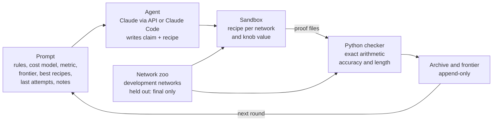
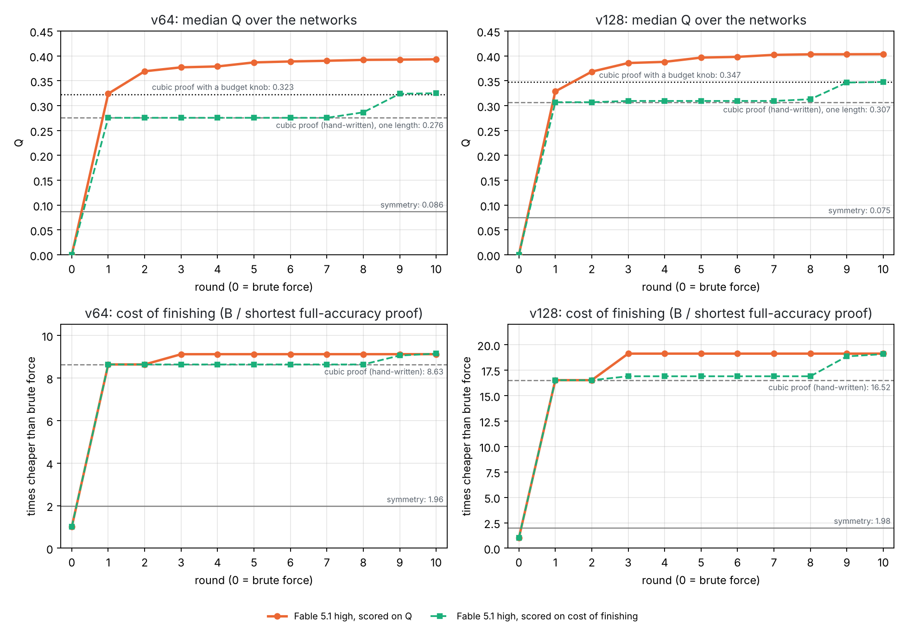
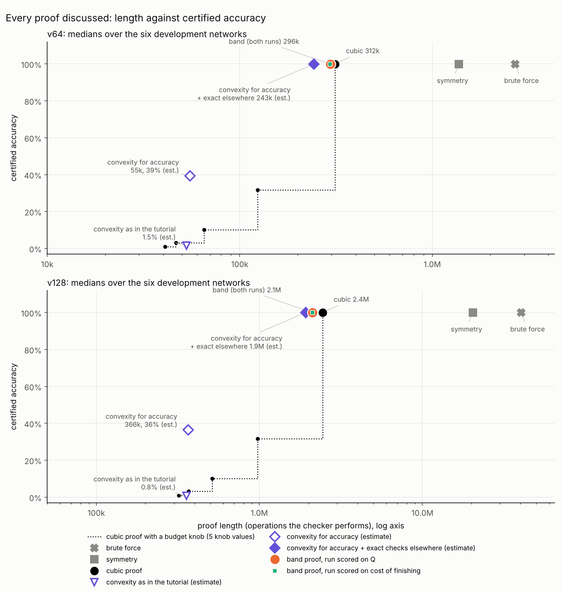

# Auto-Research-Compact-Proof

An agentic loop that hill-climbs towards better compact proofs of model performance, in the sense of [Gross et al., "Compact Proofs of Model Performance via Mechanistic Interpretability"](https://arxiv.org/abs/2406.11779). Each round, an agent proposes a claim about how a trained network computes and a recipe that turns the network's weights into a proof of a lower bound on its accuracy. A sandbox runs the recipe, a trusted checker verifies every proof with exact arithmetic and measures its length, and the scores feed the next round. A better explanation of the network shows up as a shorter proof of the same bound.

Contents: 1. the idea; 2. the agent loop; 3. the two metrics; 4. the runs of 13 October 2026; 5. the proofs found; 6. how Q can be gamed; 7. status and next steps; 8. using the pipeline.

## 1. The idea: hill-climb towards mechanistic understanding

Jason Gross, Rajashree Agrawal, Thomas Kwa, Euan Ong, Chun Hei Yip, Alex Gibson, Soufiane Noubir and Lawrence Chan, [*Compact Proofs of Model Performance via Mechanistic Interpretability*](https://arxiv.org/abs/2406.11779), NeurIPS 2024.

Their proposal: turn an understanding of how a network computes into a formal proof of a bound on its performance. In their Max-of-K study the bound is a lower bound on accuracy over all inputs. Brute force, running the network on every input, proves the exact accuracy with the longest possible proof; a proof built on the network's actual mechanism can skip most of that work. They judge a proof by two measures:

1. **Proof length**: how much computation it takes to check the proof, both as an asymptotic cost in the network's sizes and as the operations of the actual check.
2. **Bound tightness**: the proven bound divided by the true accuracy.

Comparing 102 proof strategies on these two axes, they find that shorter proofs require and provide more mechanistic understanding, and that more faithful understanding gives tighter bounds.

That turns understanding into a number that can be climbed. If shorter proofs of the same bound need more understanding, then an agent that keeps finding shorter proofs must keep finding better explanations. This repository builds the climb: an agent is scored on the length and tightness of the proofs it produces, sees its score every round, and tries to beat it. Every recipe comes with a plain-words CLAIM about the network's mechanism, and only checked proofs score, so a claim earns nothing unless it shortens a proof.

## 2. The agent loop



**The prompt.** Each round the agent receives one prompt and returns one response, with no tools. The fixed part of the prompt states the goal (a checked lower bound on accuracy, with a proof as short as possible), the network's PyTorch source and its task, what a recipe is, the proof rules and the cost model verbatim, and the metric it is scored on. The part rebuilt each round shows the scoreboard (the best certified accuracy at each proof length), the three best recipes so far with their code and results, the agent's last three attempts with diagnostics (which pieces of a proof failed and by how much, which inputs remain uncertified, the length split by rule), and the agent's own notes from earlier rounds. The template is [`core/agent/prompts/v1.md`](core/agent/prompts/v1.md); `python -m core.loop` builds it from the run's archive each round.

**The response.** Fixed sections: CLAIM (how the network computes, in plain words), WHY IT HELPS, PREDICTION, KNOB, RECIPE, NOTES, and an optional NEW RULE IDEA. The recipe is a Python function `make_proof(weights, info, knob)` that returns a proof file. Inside it the agent may do any floating-point analysis or search; none of that counts, only checking the returned proof does. The knob is a number from 0 to 1 that the agent uses to trade proof length against certified accuracy; the loop runs every recipe at knob 0, 0.25, 0.5, 0.75 and 1, so one recipe gives five points.

**The sandbox.** Recipes run in a hardened container, one per network and knob value, with no network access, no file access, a time limit (300 s) and a memory limit (2 GB). A recipe sees its weights, the sizes and the knob, nothing else; it never learns which network it is proving.

**Proof files.** A proof file is data, never code: a tree that splits the inputs into pieces and applies one rule per piece. Leaf rules: `single` (run one input exactly), `interval` (bound a whole range of inputs at once), `skip`. Global rules: `contract` (replace consecutive linear maps by their product), `symmetry` (count each sorted input for all its orderings, when the network is symmetric in its positions), and `approximate` (a simpler matrix standing in for a weight matrix, whose maximum error the checker computes exactly). Rules and their soundness arguments are in [docs/RULES.md](docs/RULES.md).

**The Python checker.** The checker rebuilds the network from its source and weights, loads the weights itself, and recomputes every claim in a proof file in exact rational arithmetic; it trusts nothing a proof says. A piece that fails certifies nothing; the rest still count. The output is the number of certified inputs and the proof's **length**: every operation the checker performs, counted under the frozen cost model [`cost-v2`](docs/COST_MODEL.md), including reading the weights and the proof file, so no work can hide. A run halts if any proof certifies more inputs than the network gets right, which a sound checker never does, and a separate audit compared 1,200 random proofs with an exact oracle that shares no code with the checker and found no unsound certificate. [docs/REWARD_HACKING.md](docs/REWARD_HACKING.md) lists what the loop guards against.

**Lean: still to do.** The checker is exact but not formally verified, so every result below is labelled Python-checked. The plan is a Lean checker with one soundness theorem per rule; then every proof file the agent writes becomes a Lean theorem about that network, with the agent writing data rather than Lean. The plan is in [docs/LEAN.md](docs/LEAN.md); nothing of it is implemented yet.

**After a run,** the recipes on the frontier are run once on held-out networks the agent never saw, and the report shows both sets of numbers.

## 3. The two metrics

For each network, let a(b) be the best certified accuracy among checked proofs of length at most b. Two lengths frame the budget axis: E, the cost of only reading the weights, which is the least any proof pays, and B, the length of brute force.

| | inputs | E | B |
| --- | --- | --- | --- |
| v64 (64 tokens, hidden width 8) | 4,096 | 1,088 | 2,696,387 |
| v128 (128 tokens, hidden width 16) | 16,384 | 4,352 | 40,407,555 |

Both metrics combine Gross et al.'s two measures, length and the accuracy bound, into one number. They differ in how they weigh partial proofs.

**Q: the area under the accuracy-against-length curve.**

$$Q = \frac{1}{\ln(B/E)} \int_E^B a(b)\, d\ln b$$

Q is the average of a(b) over all budgets from E to B, with the budgets spread evenly on a log scale, so every factor of 10 in length counts the same. It is 0 if nothing is certified below B and would be 1 if everything were certified at E. Since a(b) is a staircase, the integral is a sum of rectangles, one per proof on the frontier: proofs of lengths L₁ < L₂ < … certifying a₁ < a₂ < …, with B in place of the length after the last one,

$$Q = \frac{1}{\ln(B/E)} \sum_i a_i \ln\frac{L_{i+1}}{L_i}$$

On a normal length axis almost the whole width would lie near B, and a full proof ten times shorter than another would barely change the score; the log axis gives the short end its due weight. A worked example is [results/max2-2026-10-13/q-explained.png](results/max2-2026-10-13/q-explained.png).

**Cost of finishing: the price of certifying everything.** A proof of length L leaves U of the network's correct inputs uncertified. Finishing the job by brute force costs λ = B/n per input, with n the number of inputs, so the total is

$$\text{total} = L + \lambda U$$

and the score is B divided by the smallest total over all proofs: how many times cheaper than brute force the cheapest complete certification is. In practice the shortest full-accuracy proof wins the minimum, so cost of finishing rewards complete proofs only; Q also rewards partial ones.

The run config sets which metric the agent sees as its score; the report always shows both, plus the shortest full-accuracy proof and the best accuracy within B/10, B/100 and B/1000.

## 4. The runs of 13 October 2026

Two runs on the max-of-2 model, identical except for the metric the agent was told to maximise: [`config/max2-rerun-q.yaml`](config/max2-rerun-q.yaml) (Q) and [`config/max2-rerun-cof.yaml`](config/max2-rerun-cof.yaml) (cost of finishing).

| | |
| --- | --- |
| agent | Claude Fable 5.1, effort high, through a Claude Code subscription |
| rounds | 10 after round 0; round 0 holds brute force only, so every strategy had to be found by the agent |
| per round | one recipe, run on 6 development networks per size at 5 knob values, checked under `cost-v2` |
| agent output | 671,248 tokens (Q run) and 468,954 (cost run), about $44 and $32 at API prices |
| held out | the frontier recipes on 4 further networks per size, after the run |



Top: median Q per round. Bottom: cost of finishing per round, which is B over the shortest full-accuracy proof so far. Round 0 is brute force. The horizontal lines are reference proofs of section 5: symmetry and the hand-written cubic proof, alone and with a budget knob.

Medians over the development networks, held-out networks in brackets:

| | hand-written cubic proof | run scored on Q | run scored on cost of finishing |
| --- | --- | --- | --- |
| shortest full-accuracy proof, v64 | 312,264 | 295,698, -5.3% (292,558, -6.3%) | 294,854, -5.6% (292,558, -6.3%) |
| shortest full-accuracy proof, v128 | 2,446,083 | 2,112,262, -13.6% (2,093,111, -14.4%) | 2,117,809, -13.4% (2,117,356, -13.4%) |
| Q, v64 | 0.276 (0.323 with the knob) | 0.393 (0.396) | 0.325 (0.326) |
| Q, v128 | 0.307 (0.347 with the knob) | 0.404 (0.404) | 0.348 (0.348) |
| cost of finishing, v64 | 8.63 | 9.12 (9.22) | 9.14 (9.22) |
| cost of finishing, v128 | 16.52 | 19.13 (19.29) | 19.08 (19.09) |
| best certified within B/10, v64 | 31.8% (with the knob) | 88.7% | 39.6% |
| best certified within B/100, v64 | 0% | 11.0% | 0% |

On every network, development and held out, both runs certify exactly the inputs the network gets right (99.90% to 99.99% of them). The per-run reports, with the frontier plots and every round's claim, are [results/max2-rerun-q](results/max2-rerun-q/report.md) and [results/max2-rerun-cof](results/max2-rerun-cof/report.md); every run is listed in [results/RESULTS.md](results/RESULTS.md).

## 5. The proofs found

**The network.** The max-of-2 network of the [proof-based approach tutorial](https://github.com/LouisYRYJ/Proof_based_approach_tutorial/blob/master/proof_public.ipynb): two tokens a and b in, the larger one out. The two one-hot inputs are added, then three linear maps follow with nothing between them, so the network is linear in the summed input:

$$z(a,b) = M e_a + M e_b, \qquad M = W_U W_L W_E$$

with W_E, W_L, W_U the embedding, hidden layer and unembedding, and e_a the one-hot vector of token a. Column t of M is the whole network run on token t alone. The tutorial bounds the expected loss with three proofs (brute force, symmetry, convexity); its section on a cubic proof is an empty heading. Like Gross et al., we bound accuracy.

**The known strategies**, written for accuracy and used as references (never shown to the agent):

- **Brute force.** Run the network on every input; check that the right answer has the highest score. About V³d operations.
- **Symmetry.** The inputs are added first, so (a, b) and (b, a) give the same scores and the same answer: check only the sorted inputs a ≤ b. Half of brute force.
- **The cubic proof** ([baseline 03](models/max2/baselines/03_contract_interval.md), hand-written). Because the network is linear, the expensive matrices run once per token instead of once per input: compute M once, and the scores of any input are two columns of M added. For each sorted input a ≤ b, check

  $$z_b > z_j \quad \text{for every } j \ne b, \qquad z_j = M[j,a] + M[j,b]$$

  which costs about 2V operations (V additions, V comparisons). With about V²/2 sorted inputs that is about V³, hence the name. Nothing is approximated, so it certifies exactly the inputs the network gets right: 312,264 operations on v64 (8.6 times shorter than brute force) and 2,446,083 on v128 (16.5 times). [Baseline 04](models/max2/baselines/04_contract_interval_budget.md) is the same proof with a budget knob, so that under Q it gets the partial-proof points an agent's recipe gets.
- **Convexity** (the tutorial's third proof, and a variant of ours). The logits of (a, b) are the average of those of the doubled inputs (a, a) and (b, b), and the loss is convex in the logits, so the loss of (a, b) is at most the average of the two doubled inputs' losses against b. Only the V doubled inputs are run, so this grows like V²d, but the bound is very loose: on v64 it bounds the average loss by 17.96 against a true loss of 0.021. Applied to the margin instead of the loss ("convexity for accuracy"), the same argument proves about 39% of the v64 inputs at about a sixth of the cubic proof's length; the checker's rules cannot express it yet. Details and numbers are in the [write-up](results/max2-2026-10-13/README.md).

**What the agents found.**

*Round 1 of both runs: the cubic proof.* From brute force, both agents went straight to contraction, symmetry and one interval leaf per larger token, within 0.01% of the hand-written baseline. These ingredients are rules the checker offers and describes, so this is assembling given tools.

*The band: round 3 of the run scored on Q, rounds 9 and 10 of the run scored on cost of finishing.* The margin by which the right answer wins is small only near the diagonal, where a and b are close (about 3.5 at the median next to it, about 17 far from it). Far from the diagonal an approximate copy of M is good enough. The recipes replace the rows of M by piecewise-constant copies P, whose largest error ε the checker computes exactly. Since

$$M[b,a] - M[j,a] \ge P[b,a] - P[j,a] - 2\varepsilon$$

a range of tokens a can be checked against rival j one flat piece at a time instead of one token at a time; if the result minus 2ε is still positive, every input in the range is proved. Near the diagonal, where 2ε would exceed the margin, the inputs get the exact cubic check: that strip is the band. Several copies at different error levels let each range use the coarsest one its margins allow. The gain is 5 to 6% on v64 and 13 to 14% on v128, it holds on the held-out networks, and it grows with the vocabulary, as the share of inputs far from the diagonal does. It is modest because the rows of M are jagged (neighbouring entries of a row differ by 6.5 at the median on v64), so a copy with long flat pieces has a large error.

*Box bounds.* The cost run's round 3 bounded ranges of inputs by a box in a rotated basis, worth 2% on v128 only, until the band replaced it. The Q run's cheap partial proofs use boxes too: "coordinate boxes in the W_E / W_L·W_E coordinates stay valid over ≈15–25 consecutive tokens (widest at t ≪ m) and give the cheap partial certificates", in its own words.

*A proposed rule.* In round 8 the cost run proposed bounding far rivals through a telescoping chain of differences between neighbouring labels. A float simulation on the weights shows its bound passes for almost no label, so it was not built.

Both metrics led to essentially the same best full proof; the Q run found it in round 3, the cost run in rounds 9 and 10. With one run per metric that is suggestive, not established. Every proof discussed, on one length-against-accuracy plot:



The full write-up, with the reference table, the scripts that compute it, and figures of the cubic proof on one input and of the gaming issue, is [results/max2-2026-10-13/README.md](results/max2-2026-10-13/README.md).

## 6. How Q can be gamed

The run scored on Q beats the cubic proof with a budget knob by 0.070 (v64) and 0.056 (v128), but its shorter full proof explains only 0.005 and 0.011 of that. The rest comes from its partial proofs, which are better (cheap box bounds on the easy inputs) and also better placed.

Q never sees what a recipe could certify at each budget. It sees only the five proofs the recipe hands in, at budgets the recipe chooses, and adds up their rectangles: heights are fixed by the proofs, widths by where the budgets fall. So a recipe can raise Q by choosing its budgets well, and a recipe that is better at every budget can score lower ([figure](results/max2-2026-10-13/gaming.png)). The Q run's round-10 recipe does exactly this: "knobs 0–0.75 are four budgets chosen by an exact DP that maximises the log-length area of this recipe's own certified-accuracy step curve from E to brute force", that is,

$$\max_{L_1 < \dots < L_4} \; \sum_{i} \hat A(L_i) \ln\frac{L_{i+1}}{L_i}$$

with  its own prediction of what it can certify at each length. Every proof is real and checked; the score just rewards placing points as well as making them. The fix is for the loop, not the recipe, to fix the budgets: one log-spaced grid for every recipe, and the score is the mean of a(b) over the grid. Then recipes with the same capability get the same score.

## 7. Status and next steps

The pipeline is built and tested end to end (spec Steps 0 to 9): the max2 model folder with its trained zoo, the exact checker, the hardened sandbox, diagnostics, the prompt builder, the loop with fake, manual, API and Claude Code backends, reports, and the held-out evaluation. Two independent reviews found no soundness bug; the robustness and cost gaps they found are fixed and have regression tests. Step 10, the real runs, is under way (section 4).

A second model is the one-layer, attention-only transformer of [xorformer](https://github.com/VerifiedMechanisms/xorformer) (n bits plus a query token, softmax heads, a thresholded readout), trained on MAJORITY of 12 bits with one head: `models/xorformer-majority`. Softmax puts exp in the network, so its checker (`core/check/general.py`) bounds every value with interval arithmetic instead of computing it exactly: sums and products stay exact, and exp and softmax are enclosed by rational bounds rounded outwards. The argument is in [docs/RULES.md](docs/RULES.md). Its configs are `config/xorformer-majority-round0.yaml` (fake backend) and `config/xorformer-majority-pilot-subscription.yaml`.

Next: score with fixed budgets; add a checker rule for convexity for accuracy, with its soundness argument and an honest charge, and see whether an agent combines it with the band; implement the Lean checker; repeat each metric with more runs; run the xorformer pilot.

## 8. Using the pipeline

### Quick start

```bash
python -m pip install -r requirements.txt
python -m pytest
python -m core.loop run --config config/max2-round0.yaml
python -m core.loop status --run ~/auto-research-compact-proof-runs/max2-round0-fake
```

The zoo's weights are in the repository, so nothing needs training. The run replays the three max2 baselines as round 0, then five deliberately broken responses, and prints the frontier. It takes a few minutes, mostly waiting for the response that never ends to time out. Add `--diagnostics` to `status` to see where each attempt lost accuracy.

After a run:

```bash
python -m core.final --run ~/auto-research-compact-proof-runs/<run_id>    # frontier recipes on the held-out networks
python -m core.report --run ~/auto-research-compact-proof-runs/<run_id> --results
```

The report (tables, frontier plots, progress, the frontier recipes' claims) lands in the run folder; `--results` copies it into `results/<run_id>/` and adds a line to `results/RESULTS.md`, ready to commit.

When the cost model changes (see [docs/COST_MODEL.md](docs/COST_MODEL.md)), `python -m core.remeasure --run <run folder>` checks a finished run's proofs again under the current one and writes the new lengths next to the run, so old runs stay comparable with new ones. Runs themselves are never rewritten.

Recipes run in a sandbox. On Linux, Landlock keeps them in with no setup. On a Mac, install Docker Desktop and run `python -m core.sandbox build` once. The quick-try configs fall back to a weak mode without it and say so; the real-run configs (`sandbox: hardened`) refuse to start instead. See [docs/SANDBOX.md](docs/SANDBOX.md).

### Layout

The core in `core/` is model-agnostic. Each model lives in its own folder, `models/<name>/`, with its architecture in `model.py` and every number in `config.yaml`; switching models means pointing a run config at a different folder. Section 4 of [docs/SPEC.md](docs/SPEC.md) has the details.

### Building

Open a Claude Code session in this repository and ask it to follow `docs/SPEC.md`, starting at Step 0. `CLAUDE.md` holds the working rules.

### Running with your own API key

1. Put the key in a file outside the repository, readable only by you:

   ```bash
   mkdir -p ~/.config/auto-research-compact-proof
   printf 'CPL_ANTHROPIC_KEY=%s\n' 'sk-ant-...' > ~/.config/auto-research-compact-proof/env
   chmod 600 ~/.config/auto-research-compact-proof/env
   ```

2. Load it into the shell that starts the run. Never use `ANTHROPIC_API_KEY`: Claude Code would bill its own work to that key.

   ```bash
   set -a; . ~/.config/auto-research-compact-proof/env; set +a
   ```

3. Commit your changes (an API run starts only from a clean commit), then start the run and check on it:

   ```bash
   python -m core.loop run --config config/<run>.yaml
   python -m core.loop status --run ~/auto-research-compact-proof-runs/<run_id> --diagnostics
   ```

A run stops at `rounds_max`, after `patience` rounds without a gain, or when the API reports something waiting can't fix (a spend limit, say). Ctrl-C is safe at any point; `python -m core.loop resume --run <runs_dir>/<run_id>` continues without paying for any saved response again. Each round's `meta.json` records the tokens used and the estimated cost, priced from `config/prices.yaml`.

In the real-run configs round 0 holds brute force only: the agent is told which proof rules exist, but it has to discover the strategies (the input symmetry, contracting the linear maps, grouping inputs by their label) itself. `config/max2-round0.yaml` runs the hand-written baselines instead (and `config/max2-baselines.yaml` runs only those, on every development network), and `python -m core.report --run <run> --reference <that run>` overlays them as reference marks on the run's plots. Set `baselines` in a run config to `true`, `false` or a list of names to choose.

**No API key, but a Claude subscription?** `config/max2-pilot-subscription.yaml` and the two rerun configs of section 4 run through your own Claude Code login (`backend: claude_code`): the loop runs the official CLI headless with no tools, nothing is billed per call, and usage counts against your subscription's limits (the loop waits and resumes when it hits one). It needs `claude` installed and signed in. Anthropic's terms for Claude Code decide whether this is allowed for your account; see [docs/BACKENDS.md](docs/BACKENDS.md).

To try the loop without a key, `config/max2-manual.yaml` lets you play the agent: each round writes a prompt for you to paste into Claude, and waits for you to save the answer as `response.md`.

**Lean.** Every result is currently labelled Python-checked: the checker is exact rational arithmetic in Python, with an informal soundness argument per rule in [docs/RULES.md](docs/RULES.md). The plan for a verified Lean checker, which would turn every proof file the agent produces into a formal certificate, is [docs/LEAN.md](docs/LEAN.md).
