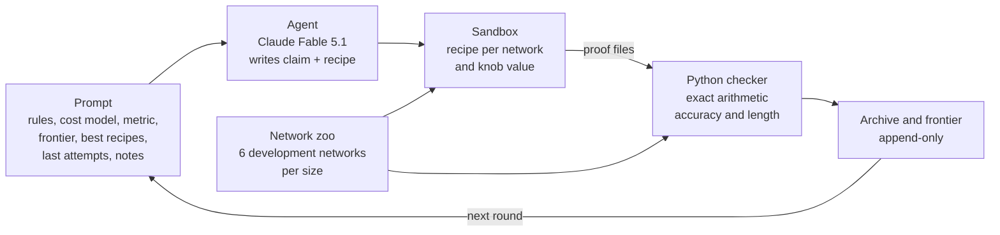
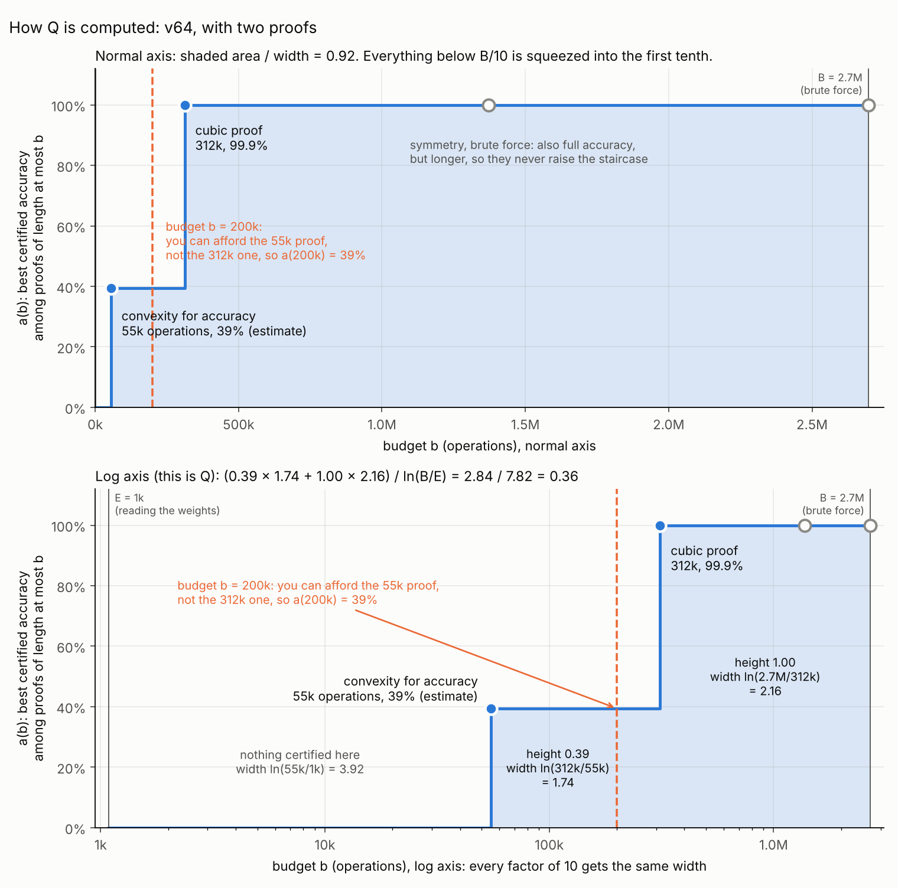
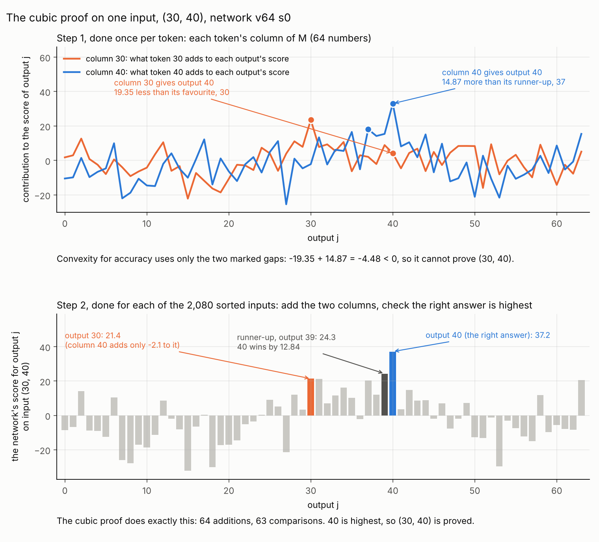
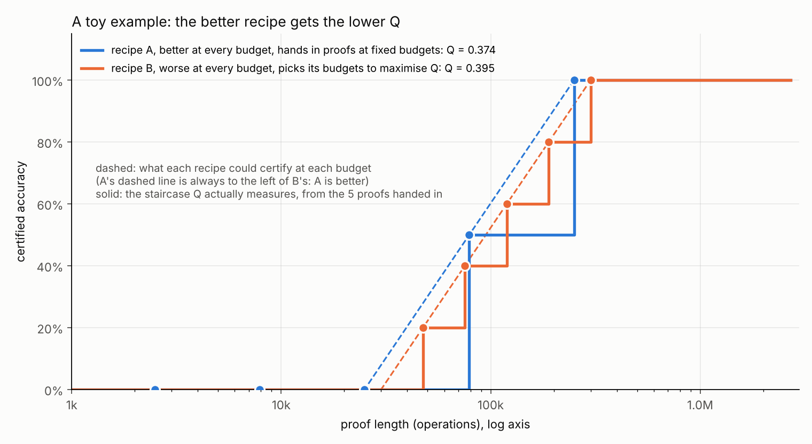

# Compact proofs for max-of-2: an agent loop, two metrics, two runs

The short version of this write-up is the repository README; this page keeps the full reference table and all figures.

Results of 13 October 2026, with the background needed to read them. All numbers from the runs and the baselines come from the exact Python checker; numbers marked "estimate" come from floating-point analysis of strategies the checker cannot yet express. No result is Lean-checked yet (section 2).

Contents: 1. compact proofs; 2. the agent loop; 3. the two metrics; 4. the network and the known proofs; 5. the two runs; 6. what the agents found; 7. how Q can be gamed; 8. caveats and next steps.

## 1. Compact proofs (Gross et al.)

Jason Gross, Rajashree Agrawal, Thomas Kwa, Euan Ong, Chun Hei Yip, Alex Gibson, Soufiane Noubir and Lawrence Chan, [*Compact Proofs of Model Performance via Mechanistic Interpretability*](https://arxiv.org/abs/2406.11779), NeurIPS 2024.

The idea: turn an understanding of how a network computes into a formal proof of a bound on its performance. In their Max-of-K study the bound is a lower bound on accuracy over all inputs. They judge a proof by two measures:

1. **Proof length**: how much computation it takes to check the proof, both as an asymptotic cost in the network's sizes and as the operations of the actual check.
2. **Bound tightness**: the proven bound divided by the true accuracy.

Brute force, running the network on every input, gives a perfectly tight bound with the longest proof. A proof built on a real mechanism can skip most of that work. Comparing 102 proof strategies on these two axes, they find that shorter proofs require and provide more mechanistic understanding, and that more faithful understanding gives tighter bounds. That is what makes proof length usable as a measure of understanding, and what this repository builds on.

## 2. The agent loop

**The agent's task.** Each round the agent receives one prompt and returns one response, with no tools. The prompt's fixed part states the goal (a checked lower bound on accuracy with a proof as short as possible), the network's PyTorch source and task, what a recipe is, the proof rules and the cost model verbatim, and the metric. The part rebuilt each round shows the scoreboard (best certified accuracy at each length), the three best recipes so far with their code and results, the agent's last three attempts with diagnostics (which pieces failed and by how much, which inputs remain uncertified, the length by rule), and the agent's own notes from earlier rounds. The template is [`core/agent/prompts/v1.md`](../../core/agent/prompts/v1.md).

**The response.** Fixed sections: CLAIM (how the network computes, in plain words), WHY IT HELPS, PREDICTION, KNOB, RECIPE, NOTES, and an optional NEW RULE IDEA. The recipe is a Python function `make_proof(weights, info, knob)` that returns a proof file. Inside it the agent may do any floating-point analysis or search; only checking the returned proof counts. The knob is a number from 0 to 1 that the agent uses to trade length against accuracy; the loop runs every recipe at knob 0, 0.25, 0.5, 0.75 and 1.

**The sandbox.** Recipes run in a hardened container, one per network and knob value, with no network access, no file access, 300 seconds and 2 GB each. A recipe never learns which network it is proving.

**Proof files and the checker.** A proof file is data, not code: a tree that splits the inputs into pieces, with one rule per piece (`single`: run one input exactly; `interval`: bound a whole range of inputs at once; `skip`), and global rules `contract` (multiply consecutive linear maps into one matrix), `symmetry` (count each sorted input for all its orderings) and `approximate` (a simpler matrix whose maximum error the checker computes exactly). The checker rebuilds the network from its source and weights and recomputes every claim in exact rational arithmetic. A piece that fails certifies nothing; the rest still count. The proof's **length** is every operation the checker performs, under the cost model [`cost-v2`](../../docs/COST_MODEL.md), including reading the weights and the proof file.

**Guards.** A run halts if any proof certifies more inputs than the network gets right, which a sound checker never does. A separate audit compared 1,200 random proofs (6.9 million certified inputs) with an exact oracle that shares no code with the checker, and found no unsound certificate. [docs/REWARD_HACKING.md](../../docs/REWARD_HACKING.md) lists what else the loop guards against.

**Lean: still to do.** The checker is exact but not formally verified, so every result here is labelled Python-checked. The plan is a Lean checker with one soundness theorem per rule, under which every proof file the agent writes becomes a Lean theorem about that network: [docs/LEAN.md](../../docs/LEAN.md). It has not been implemented yet.

**After a run**, the recipes on the frontier are run once on the held-out networks, which the agent never saw.

## 3. The two metrics

For each network, let a(b) be the best certified accuracy among checked proofs of length at most b. Two lengths frame it: E, the cost of just reading the weights (the least any proof pays), and B, the length of brute force.

| | inputs | E | B |
| --- | --- | --- | --- |
| v64 | 4,096 | 1,088 | 2,696,387 |
| v128 | 16,384 | 4,352 | 40,407,555 |

Both metrics combine Gross et al.'s two measures, length and the accuracy bound, into one number that can be hill-climbed. They differ in how they weigh partial proofs.

### Q: the area under the accuracy-against-length curve

$$Q = \frac{1}{\ln(B/E)} \int_E^B a(b)\, d\ln b$$

Q is the average of a(b) over all budgets from E to B, with the budgets spread evenly on a log scale, so every factor of 10 in length counts the same. It is 0 if nothing is certified below B and 1 if everything were certified at E. Because a(b) is a staircase, the integral is a sum of rectangles, one per proof on the frontier: proofs of lengths L₁ < L₂ < … certifying a₁ < a₂ < …, with B in place of the length after the last one:

$$Q = \frac{1}{\ln(B/E)} \sum_i a_i \ln\frac{L_{i+1}}{L_i}$$

On a normal length axis almost the whole width lies near B, so a full proof ten times shorter than another would barely change the score; the log axis gives the short end its due weight.

### Cost of finishing: the price of certifying everything

A proof of length L leaves U of the network's correct inputs uncertified. Finishing the job by brute force costs λ = B/n per input, with n the number of inputs, so the total is

$$\text{total} = L + \lambda U$$

and the score is B divided by the smallest total over all proofs: how many times cheaper than brute force the cheapest complete certification is. Dividing the total by B shows what it counts: L/B, the proof's length as a fraction of brute force, plus U/n, the share of inputs left over. In practice the shortest full-accuracy proof wins the minimum, so cost of finishing rewards complete proofs only; Q also rewards partial ones.

### What the loop is for

The run config sets which metric the agent sees as its score; the report shows both. The loop hill-climbs that score: each round the agent sees the frontier and tries to beat it. The premise, from Gross et al., is that shorter proofs of the same bound need more understanding, so climbing the score should push the agent towards better explanations of the network. Each recipe comes with a CLAIM, the explanation it is built on, and only checked proofs score, so a better explanation has to show up as a shorter proof.

## 4. The network and the known proofs

The model is the max-of-2 network of the [proof-based approach tutorial](https://github.com/LouisYRYJ/Proof_based_approach_tutorial/blob/master/proof_public.ipynb): two tokens a and b in, the larger one out. The two one-hot inputs are added, then three linear maps follow with nothing between them, so the network is linear in the summed input:

$$z(a,b) = M e_a + M e_b, \qquad M = W_U W_L W_E$$

Here W_E, W_L and W_U are the embedding, the hidden layer and the unembedding, and e_a is the one-hot vector of token a. Two sizes: v64 (V = 64 tokens, hidden width d = 8) and v128 (V = 128, d = 16). Ten networks per size, trained from different seeds: six for the runs, four held out. They classify 99.90% to 99.99% of inputs correctly.

The tutorial bounds the expected loss with three proofs (brute force, symmetry, convexity); its section on a cubic proof is an empty heading. Like Gross et al., we bound accuracy. These are the known strategies, written for accuracy:

- **Brute force.** Run the network on every input and check that the right answer has the highest score.
- **Symmetry.** The inputs are added first, so (a, b) and (b, a) give the same scores and the same answer. Check only the sorted inputs a ≤ b.
- **Cubic proof** ([baseline 03](../../models/max2/baselines/03_contract_interval.md), ours). Linearity lets the expensive matrices run once per token instead of once per input: compute M once, then the scores of any input are two columns of M added. For each sorted input a ≤ b the check is

  $$z_b > z_j \quad \text{for every } j \ne b, \qquad z_j = M[j,a] + M[j,b]$$

  which costs about 2V operations: V additions and V comparisons. With about V²/2 sorted inputs that is about V³, hence the name. Nothing is approximated, so it certifies exactly the inputs the network gets right. Baseline 04 is the same proof with a budget knob, so that it gets partial-proof points under Q as an agent's recipe does.
- **Convexity, as in the tutorial.** The logits of (a, b) are the average of those of the doubled inputs (a, a) and (b, b), and the loss is convex in the logits, so

  $$\ell(a,b) \le \tfrac12 \ell_b(a,a) + \tfrac12 \ell_b(b,b)$$

  where ℓ_b(x, x) scores the doubled input against b. Only the V doubled inputs are run. But (a, a) confidently answers a, so ℓ_b(a, a) is large, and a loss can never go below zero to make up for it: on network v64 s0 the bound on the average loss is 17.96 against a true loss of 0.0214. Used for accuracy (an input is proved correct when its bound is below ln 2), it proves little more than the diagonal inputs, which it runs exactly anyway.
- **Convexity for accuracy** (ours, an estimate). The same argument applied to the margin, which can be negative. With

  $$\mathrm{lead}_b(t) = M[b,t] - \max_{j \ne b} M[j,t]$$

  an input (a, b) is proved correct when lead_b(a) + lead_b(b) > 0. Each column is compared with its own worst rival, once per column, so each input costs a few operations instead of 2V. It proves 39% of the v64 inputs. The checker cannot express it: every rule compares both columns with the same rival.
- **Convexity for accuracy plus exact checks** (ours, an estimate). The bound where it holds and the cubic check elsewhere: a full-accuracy proof.

| proof | certifies v64 / v128 | grows like | length v64 | length v128 | Q v64 / v128 | cost of finishing v64 / v128 | |
| --- | --- | --- | --- | --- | --- | --- | --- |
| brute force | all correct inputs | V³d | 2,696,387 | 40,407,555 | 0 / 0 | 1.0 / 1.0 | checked |
| symmetry | all | V³d / 2 | 1,372,250 | 20,372,796 | 0.086 / 0.075 | 1.97 / 1.98 | checked |
| cubic proof | all | V³ | 312,264 | 2,446,083 | 0.276 / 0.307 | 8.63 / 16.52 | checked |
| cubic proof with a budget knob | 1% to all | V³ | 5 points | 5 points | 0.323 / 0.347 | 8.63 / 16.52 | checked |
| convexity as in the tutorial | 1.5% / 0.8% | V²d | ~53k | ~358k | 0.008 / 0.004 | 1.0 / 1.0 | estimate |
| convexity for accuracy | 39% / 36% | V²d | ~55k | ~366k | 0.196 / 0.188 | 1.6 / 1.6 | estimate |
| convexity for accuracy + exact checks | all | V³, smaller constant | ~243k | ~1.93M | 0.308 / 0.333 | 11.1 / 21.0 | estimate |
| the two above together | | | | | 0.383 / 0.399 | 11.1 / 21.0 | estimate |

Medians over the six development networks. "All" means every input the network gets right. The estimates use operation charges that are guesses (stated in [reference_proofs.py](reference_proofs.py), which computes the whole table and writes [reference_proofs.json](reference_proofs.json)).

What the cubic proof does with one input, and why convexity for accuracy cannot prove the same input:

## 5. The two runs

Two runs, identical except for the metric the agent was told to maximise: [`config/max2-rerun-q.yaml`](../../config/max2-rerun-q.yaml) (Q) and [`config/max2-rerun-cof.yaml`](../../config/max2-rerun-cof.yaml) (cost of finishing).

| | |
| --- | --- |
| agent | Claude Fable 5.1, effort high, through a Claude Code subscription |
| rounds | 10 after round 0; round 0 holds brute force only, so every strategy had to be found |
| per round | one recipe, run on 6 development networks per size at 5 knob values, checked under `cost-v2` |
| agent output | 671,248 tokens (Q run) and 468,954 (cost run), about $44 and $32 at API prices |
| held out | the frontier recipes on 4 networks per size, after the run |

Top: median Q per round. Bottom: cost of finishing per round. The grey, black and violet lines are the reference proofs of section 4; the violet ones are estimates.

**Results** (medians; held-out networks in brackets):

| | hand-written cubic proof | run scored on Q | run scored on cost of finishing |
| --- | --- | --- | --- |
| shortest full-accuracy proof, v64 | 312,264 | 295,698, -5.3% (292,558, -6.3%) | 294,854, -5.6% (292,558, -6.3%) |
| shortest full-accuracy proof, v128 | 2,446,083 | 2,112,262, -13.6% (2,093,111, -14.4%) | 2,117,809, -13.4% (2,117,356, -13.4%) |
| Q, v64 | 0.276 (0.323 with the knob) | 0.393 (0.396) | 0.325 (0.326) |
| Q, v128 | 0.307 (0.347 with the knob) | 0.404 (0.404) | 0.348 (0.348) |
| cost of finishing, v64 | 8.63 | 9.12 (9.22) | 9.14 (9.22) |
| cost of finishing, v128 | 16.52 | 19.13 (19.29) | 19.08 (19.09) |
| best certified within B/10, v64 | 31.8% (with the knob) | 88.7% | 39.6% |
| best certified within B/100, v64 | 0% | 11.0% | 0% |

On every network, development and held out, both runs certify exactly the inputs the network gets right. The per-run reports are [max2-rerun-q](../max2-rerun-q/report.md) and [max2-rerun-cof](../max2-rerun-cof/report.md).

## 6. What the agents found

**Round 1, both runs: the cubic proof.** From brute force, both agents went straight to contraction, symmetry and one interval leaf per larger token, within 0.01% of the hand-written baseline. These ingredients are rules the checker offers and describes, so this is assembling given tools rather than discovering them.

**The band: the run scored on Q in round 3, the run scored on cost of finishing in rounds 9 and 10.** The margin by which the right answer wins is small only near the diagonal, where a and b are close: about 3.5 at the median next to it and about 17 far from it. Far from the diagonal an approximate copy of M is good enough. The recipes replace the rows of M by piecewise-constant copies P, whose largest error ε the checker computes exactly. Since

$$M[b,a] - M[j,a] \ge P[b,a] - P[j,a] - 2\varepsilon$$

a range of tokens a can be checked against rival j one flat piece at a time instead of one token at a time, and if the result minus 2ε is still positive, every input in the range is proved. Near the diagonal, where 2ε would exceed the margin, the inputs get the exact cubic check: that strip is the band. Several copies at different error levels let each range use the coarsest one its margins allow. The gain is 5 to 6% on v64 and 13 to 14% on v128, and it holds on the held-out networks, so the recipe is not tuned to particular weights. It grows with the vocabulary, as the share of inputs far from the diagonal does. The gain is modest because the rows of M are jagged (on network v64 s0, neighbouring entries of a row differ by 6.5 at the median), so a copy with long flat pieces has a large error.

**Box bounds.** The cost run's round 3 bounded ranges of inputs by a box in a rotated basis, worth 2% on v128 only, until the band replaced it. The Q run's cheap partial proofs use boxes too: in its words, "coordinate boxes in the W_E / W_L·W_E coordinates stay valid over ≈15–25 consecutive tokens (widest at t ≪ m) and give the cheap partial certificates".

**A proposed rule.** In round 8 the cost run proposed bounding far rivals through a telescoping chain of differences between neighbouring labels. A float simulation on the weights shows its bound passes for almost no label, so it was not built.

**Not found:** convexity for accuracy. The rules give no way to write it.

**How the agents explain the network.** The Q run's later claims describe M as "a smoothed tent M[j,t] ≈ βj − γ·relu(j−t)" whose critical margins are against the neighbouring labels; the cost run's last claim says "Off the diagonal M[j,t] ≈ C(j) + g(t)". These are the agents' own explanations, not verified; the measured jaggedness of the rows above sits uneasily with "smooth".

Both metrics led to essentially the same best full proof; the Q run found it in round 3, the cost run in rounds 9 and 10. With one run per metric that is suggestive, not established.

## 7. How Q can be gamed: where the partial proofs sit

The run scored on Q beats the cubic proof with a budget knob by 0.070 (v64) and 0.056 (v128). Very little of that is the shorter full proof: swapping the band proof in as the knob baseline's full proof raises its Q by only 0.005 and 0.011. The rest comes from the run's partial proofs, which are better (cheap box bounds on the easy inputs) and also better placed. That second part is a weakness of Q.

**Why placement matters.** A recipe has a capability: at each budget L, the most it could certify, Â(L). Q never sees that curve. It sees only the five proofs the recipe hands in, at budgets the recipe chooses, and adds up their rectangles. Heights are fixed by the proofs; widths are set by where the budgets fall. So a recipe can raise Q without any better proof by choosing its budgets well, and a recipe that is better at every budget can score lower:

**What the recipe actually does.** The Q run's round-10 knob text: "knobs 0–0.75 are four budgets chosen by an exact DP that maximises the log-length area of this recipe's own certified-accuracy step curve from E to brute force". That is, with L₅ its cheapest full proof, it solves

$$\max_{L_1 < \dots < L_4} \; \sum_{i} \hat A(L_i) \ln\frac{L_{i+1}}{L_i}$$

using its own predictions of the checker's costs, separately on each network. The best budgets sit exactly where  jumps, so each point stays the best for as long as possible. Every proof is real and checked; the score just rewards placing the points as well as making them. The hand-written baseline uses fixed budgets (1%, 3.2%, 10%, 32% and 100% of its full proof's checking work), so part of the Q run's lead over it is placement. We have not measured how much.

**The fix.** The loop, not the recipe, fixes the budgets: one log-spaced grid b₁ … b_K for everyone, and each recipe hands in its best proof within each budget:

$$Q_{\text{grid}} = \frac{1}{K} \sum_{k=1}^{K} a(b_k)$$

Then two recipes with the same capability get the same score, and only better proofs raise it.

## 8. Caveats and next steps

- One run per metric, so the differences between the runs are suggestive.
- Python-checked only, until the Lean checker exists.
- The convexity numbers are estimates with guessed charges.
- Next: score with fixed budgets (Q_grid); add a checker rule for convexity for accuracy, with its soundness argument and an honest charge, and see whether an agent combines it with the band; implement the Lean checker; repeat each metric with more runs.

The older two-page summary of these runs is [compact-proofs-max2-results.pdf](compact-proofs-max2-results.pdf). The figures are drawn by [plot.py](plot.py) and [explain_figures.py](explain_figures.py).
