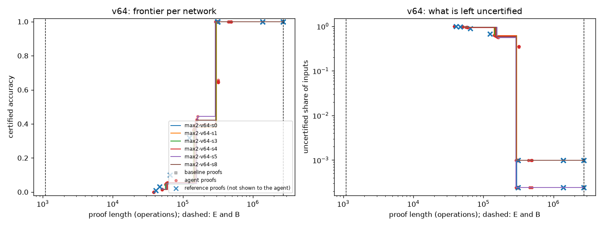
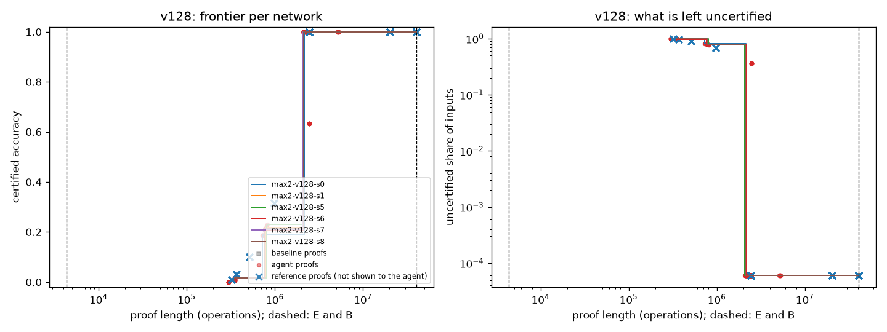
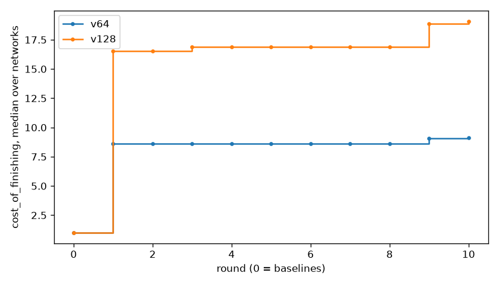

# Report: max2-rerun-cof

- Model: `models/max2`; backend claude_code
- Rounds done: 10 agent rounds after round 0; metric cost_of_finishing
- Code: commit 4e778768165da966e669030f66c33fef97b280d6
- Cost model cost-v2, rule set 7a65603db9971d13, prompt template v1, sandbox container
- Agent use: 28 input and 468,954 output tokens, about $0.00 billed (about $32.14 at API prices, covered by a subscription)
- Every number is Python-checked: this model has no Lean checker yet.

## Results per size setting

### v64 (6 development networks)

| Metric | Median network | Worst network |
| --- | --- | --- |
| Q | 0.3250 | 0.3229 |
| cost of finishing (B / total) | 9.15 | 8.97 |
| shortest proof at full accuracy, as B/x | B/9.1 | B/9.0 |
| best certified accuracy within B/10 | 39.648% | 38.135% |
| best certified accuracy within B/100 | 0.000% | 0.000% |
| best certified accuracy within B/1000 | 0.000% | 0.000% |

### v128 (6 development networks)

| Metric | Median network | Worst network |
| --- | --- | --- |
| Q | 0.3477 | 0.3449 |
| cost of finishing (B / total) | 19.08 | 18.77 |
| shortest proof at full accuracy, as B/x | B/19.1 | B/18.8 |
| best certified accuracy within B/10 | 99.994% | 99.994% |
| best certified accuracy within B/100 | 1.593% | 1.550% |
| best certified accuracy within B/1000 | 0.000% | 0.000% |

## Reference proofs (never shown to the agent)

Round-0 baselines of run `max2-baselines`, drawn as crosses in the frontier plots:

- v64: 01_brute_force: length 2,696,387 (B/1.0), certified 99.902% (medians)
- v128: 01_brute_force: length 40,407,555 (B/1.0), certified 99.994% (medians)
- v64: 02_symmetry: length 1,372,250 (B/2.0), certified 99.902% (medians)
- v128: 02_symmetry: length 20,372,796 (B/2.0), certified 99.994% (medians)
- v64: 03_contract_interval: length 312,264 (B/8.6), certified 99.902% (medians)
- v128: 03_contract_interval: length 2,446,083 (B/16.5), certified 99.994% (medians)
- v64: 04_contract_interval_budget: length 65,308 (B/41.3), certified 10.059% (medians)
- v128: 04_contract_interval_budget: length 512,683 (B/78.8), certified 10.028% (medians)

## Progress

## Recipes that hold the frontier

**round 8** (on 12 of 12 networks)

> The network is a single linear map, logits = M[:,a] + M[:,b] with M = U·L·E (rank d), so sorted (a ≤ b) is correct iff M[b,a]−M[j,a] + M[b,b]−M[j,b] > 0 for all j ≠ b, binding at j = b±1. For a fixed input the logit profile over labels j is (nearly) unimodal with its peak at b, so every far competitor j is dominated through the telescoping chain ℓ_b − ℓ_j = Σ_{k=j+1}^{b} [D_k(a) + D_k(b)] with D_k(t) = M[k,t] − M[k−1,t]; replacing each D_k(a) by its min over the leaf's token range gives a certificate whose cost is V² instead of V³, and the only pairs it cannot certify are the ones the exact rule also cannot.

**round 9** (on 12 of 12 networks)

> The network is one linear map, logits = M[:,a] + M[:,b] with M = U·L·E of rank d, so a sorted pair (a ≤ b) is correct iff M[b,a]−M[j,a] + M[b,b]−M[j,b] > 0 for all j ≠ b; the margin is tight only against the few nearest competitors j = b±1, b±2, while for far competitors it is large enough that a coordinate-wise (rank-d box) bound over the whole token range should still be positive. The exact V³ check is therefore wasted almost entirely on far competitors that a 2d-per-token box bound could dismiss.

**round 10** (on 10 of 12 networks)

> The network is one linear map on the token-count vector, logits = M[:,a] + M[:,b] with M = U·L·E of rank d, so a sorted pair (a ≤ b) is correct iff M[b,a]−M[j,a] + M[b,b]−M[j,b] > 0 for all j ≠ b, binding only at the adjacent competitors j = b±1 whose margins are nearly flat in a but wiggle at the margin scale (so no coordinate-wise/box bound is tight). Off the diagonal M[j,t] ≈ C(j) + g(t): rows share a common slope g, which is why piecewise-constant row approximations only pay where the slope is locally small.

## Agent attempts by status

crash 36, ok 564

## Held-out networks (checked by Python)

### v64

| Metric | Development | Held out |
| --- | --- | --- |
| Q_median | 0.325 | 0.3262 |
| Q_worst | 0.3229 | 0.3244 |
| cost_of_finishing_median | 9.145 | 9.2191 |
| cost_of_finishing_worst | 8.9704 | 9.0665 |
| shortest_full_over_B_median | 0.1094 | 0.1085 |

### v128

| Metric | Development | Held out |
| --- | --- | --- |
| Q_median | 0.3477 | 0.3476 |
| Q_worst | 0.3449 | 0.3468 |
| cost_of_finishing_median | 19.0799 | 19.0892 |
| cost_of_finishing_worst | 18.7714 | 18.8459 |
| shortest_full_over_B_median | 0.0524 | 0.0524 |
