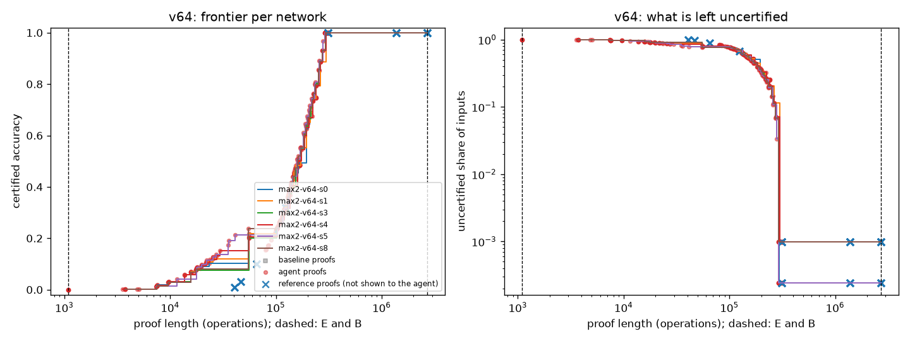
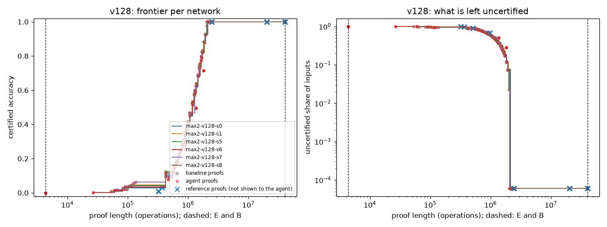
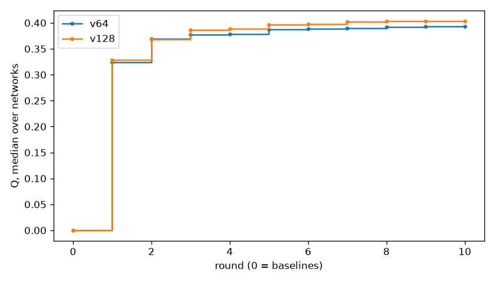

# Report: max2-rerun-q

- Model: `models/max2`; backend claude_code
- Rounds done: 10 agent rounds after round 0; metric Q
- Code: commit 4e778768165da966e669030f66c33fef97b280d6
- Cost model cost-v2, rule set 7a65603db9971d13, prompt template v1, sandbox container
- Agent use: 30 input and 671,248 output tokens, about $0.00 billed (about $43.64 at API prices, covered by a subscription)
- Every number is Python-checked: this model has no Lean checker yet.

## Results per size setting

### v64 (6 development networks)

| Metric | Median network | Worst network |
| --- | --- | --- |
| Q | 0.3933 | 0.3882 |
| cost of finishing (B / total) | 9.12 | 9.03 |
| shortest proof at full accuracy, as B/x | B/9.1 | B/9.0 |
| best certified accuracy within B/10 | 88.721% | 88.550% |
| best certified accuracy within B/100 | 11.023% | 7.617% |
| best certified accuracy within B/1000 | 0.000% | 0.000% |

### v128 (6 development networks)

| Metric | Median network | Worst network |
| --- | --- | --- |
| Q | 0.4036 | 0.4005 |
| cost of finishing (B / total) | 19.13 | 18.97 |
| shortest proof at full accuracy, as B/x | B/19.1 | B/19.0 |
| best certified accuracy within B/10 | 99.994% | 99.994% |
| best certified accuracy within B/100 | 4.251% | 2.991% |
| best certified accuracy within B/1000 | 0.000% | 0.000% |

## Reference proofs (never shown to the agent)

Round-0 baselines of run `max2-baselines`, drawn as crosses in the frontier plots:

- v64: 01_brute_force: length 2,696,387 (B/1.0), certified 99.902% (medians)
- v128: 01_brute_force: length 40,407,555 (B/1.0), certified 99.994% (medians)
- v64: 02_symmetry: length 1,372,250 (B/2.0), certified 99.902% (medians)
- v128: 02_symmetry: length 20,372,796 (B/2.0), certified 99.994% (medians)
- v64: 03_contract_interval: length 312,264 (B/8.6), certified 99.902% (medians)
- v128: 03_contract_interval: length 2,446,083 (B/16.5), certified 99.994% (medians)
- v64: 04_contract_interval_budget: length 65,308 (B/41.3), certified 10.059% (medians)
- v128: 04_contract_interval_budget: length 512,683 (B/78.8), certified 10.028% (medians)

## Progress

## Recipes that hold the frontier

**round 1** (on 12 of 12 networks)

> The network is purely linear in the summed one-hot input, so logits(a, b) = M[:, a] + M[:, b] with M = W_U·W_L·W_E a rank-d_model V×V matrix; the output is symmetric in the two positions and the label is the larger token, so only the sorted inputs (t, m) with t ≤ m need checking, label m.

**round 2** (on 11 of 12 networks)

> The network is purely linear in the summed one-hot input: logits(a,b) = M[:,a] + M[:,b] with M = W_U·W_L·W_E of rank d_model, symmetric in the two positions, so only sorted inputs (t,m), t ≤ m, label m, need checking. The margin for output j at (t,m) is (A[m]−A[j])·x(t) + (M[m,m]−M[j,m]) with x(t) = W_E[:,t]; the embedding of a token range lies on a low-dimensional curve, so a box (centre/radius) over that curve, in a well-chosen r-dimensional basis, certifies a whole range of t at O(r) per token instead of O(V).

**round 3** (on 12 of 12 networks)

> The network is purely linear in the summed one-hot input: logits(a,b) = M[:,a] + M[:,b] with M = W_U·W_L·W_E (rank d_model), symmetric in the two positions, so only sorted inputs (t,m), t ≤ m, label m, need checking; the rows of M are smooth, slowly varying functions of the token, so each row is piecewise constant to within a small tolerance eps using far fewer than V segments, and the margin of label m over output j on a whole token range is the range-minimum of a piecewise-constant difference, computable in a few merge steps instead of 2V per token.

**round 4** (on 12 of 12 networks)

> The network is purely linear in the summed one-hot input: logits(a,b) = M[:,a] + M[:,b] with M = W_U·W_L·W_E (rank d_model), symmetric in the two positions, so only sorted inputs (t,m), t ≤ m, label m, need checking; rows of M are smooth in the token, so a row_segments approximation of M with a tolerance eps needs far fewer than V segments per row away from each row's own "step", and the margin of label m over output j on a token range is a range-minimum of a piecewise-constant difference, computed in a few merge steps instead of 2V per token.

**round 5** (on 12 of 12 networks)

> The network is purely linear in the summed one-hot input: logits(a,b) = M[:,a] + M[:,b] with M = W_U·W_L·W_E (rank d_model), symmetric in the positions, so only sorted pairs (t,m), t ≤ m, label m, need checking; each row j of M is a smoothed tent/kink in t with its break near t = j, so the margins of label m against its neighbours m±1 are nearly constant in t and small (≈ scale/V), which is why every per-token approximation needs resolution ≈ 1/V and the dense V³ check is essentially the floor for 100%; the remaining freedom is where on the length axis the partial certificates are placed and a low-rank "difference basis" (rows ≈ A[j_k+1] − A[j_k]) whose coordinates are flat below their break, which can widen boxes in the easy region t ≪ m.

**round 6** (on 12 of 12 networks)

> The network is purely linear in the summed one-hot input: logits(a,b) = M[:,a] + M[:,b] with M = W_U·W_L·W_E (rank d_model) and symmetric in the two positions, so only sorted pairs (t,m), t ≤ m, label m, need checking. M is a smoothed tent M[j,t] ≈ βj − γ·relu(j−t) (β < γ < 2β); its consecutive row differences D_i = M[i,·] − M[i−1,·] are smoothed upward steps at t ≈ i, so for j<m the margin M[m,t]−M[j,t] = Σ_{i=j+1}^{m} D_i[t] is non-decreasing in t and the neighbour margins (vs m±1) are nearly constant and small (≈ scale/V).

**round 7** (on 12 of 12 networks)

> The network is purely linear in the summed one-hot input: logits(a,b) = M[:,a] + M[:,b] with M = W_U·W_L·W_E (rank d_model), symmetric in the two positions, so only sorted pairs (t,m), t ≤ m, label m, need checking. M is a rank-d_model smoothing of the tent βj − γ·relu(j−t): coordinate boxes in the embedding (or W_L·W_E) coordinates stay valid over 15–20 consecutive tokens, widest far below the label (t ≪ m), so the cheapest certificates are one wide box per label at the bottom of its range, each costing ≈3rV once plus 2r per token.

**round 8** (on 12 of 12 networks)

> The network is purely linear in the summed one-hot input: logits(a,b) = M[:,a] + M[:,b] with M = W_U·W_L·W_E (rank d_model), symmetric in the two positions, so only sorted pairs (t,m), t ≤ m, label m, need checking. M is a rank-d_model smoothing of the tent βj − γ·relu(j−t), so the critical margin of every label is against its neighbours m±1 and is ≈ scale/(4V) for every t; this fixes the full-accuracy cost at ≈ V³ + rV² (dense per-token checks) and makes coordinate boxes in the embedding / W_L·W_E coordinates valid only over ≈15–25 consecutive tokens (widest at t ≪ m), so the cheap certificates are a few wide bottom boxes per high label.

**round 9** (on 12 of 12 networks)

> The network is purely linear in the summed one-hot input: logits(a,b) = M[:,a] + M[:,b] with M = W_U·W_L·W_E (rank d_model), symmetric in the two positions, so only sorted pairs (t,m), t ≤ m, label m, need checking; M is a rank-d_model smoothing of the tent βj − γ·relu(j−t), whose critical neighbour margins (vs m±1) are ≈ scale/(4V) for every t, so dense per-token checks pin the full point at ≈V³+rV² while coordinate boxes in the W_E / W_L·W_E coordinates stay valid over ≈15–25 tokens (widest at t ≪ m) and give the cheap partial certificates.

**round 10** (on 12 of 12 networks)

> The network is purely linear in the summed one-hot input: logits(a,b) = M[:,a] + M[:,b] with M = W_U·W_L·W_E (rank d_model), symmetric in the two positions, so only sorted pairs (t,m), t ≤ m, label m, need checking. M is a rank-d_model smoothing of the tent βj − γ·relu(j−t), whose critical neighbour margins (vs m±1) are ≈ scale/(4V) for every t, so the full-accuracy proof is pinned at ≈V³+rV² (dense per-token checks on the contracted M plus a few row_segments approximations), while coordinate boxes in the W_E / W_L·W_E coordinates stay valid over ≈15–25 consecutive tokens (widest at t ≪ m) and give the cheap partial certificates.

## Agent attempts by status

ok 600

## Held-out networks (checked by Python)

### v64

| Metric | Development | Held out |
| --- | --- | --- |
| Q_median | 0.3933 | 0.3957 |
| Q_worst | 0.3882 | 0.3905 |
| cost_of_finishing_median | 9.119 | 9.2206 |
| cost_of_finishing_worst | 9.025 | 9.0402 |
| shortest_full_over_B_median | 0.1097 | 0.1085 |

### v128

| Metric | Development | Held out |
| --- | --- | --- |
| Q_median | 0.4036 | 0.4041 |
| Q_worst | 0.4005 | 0.3984 |
| cost_of_finishing_median | 19.1301 | 19.2926 |
| cost_of_finishing_worst | 18.9669 | 18.9382 |
| shortest_full_over_B_median | 0.0523 | 0.0518 |
