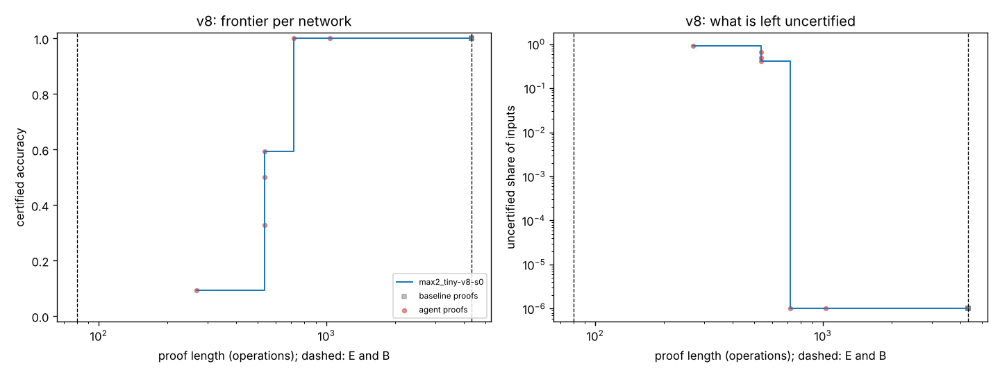
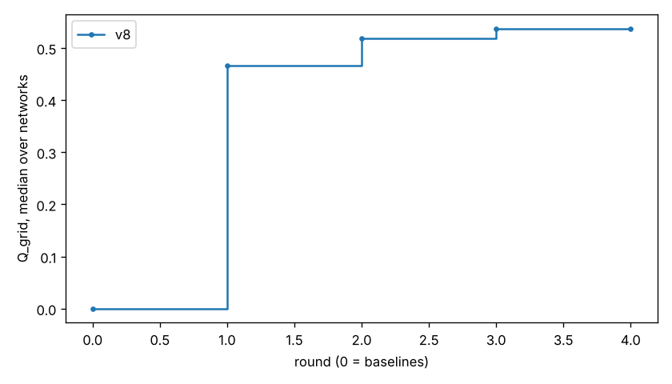

# Report: open-lane-pilot-tiny-3

- Model: `tests/max2_tiny`; backend claude_code
- Rounds done: 4 agent rounds after round 0; metric Q_grid
- Code: commit 6608098b973ea787c68307ac3780f6c60af3e703
- Cost model cost-v3, rule set 45712f4478a0bd0c, prompt template open_lane_v1, sandbox process
- Agent use: 2,056 input and 1,027,280 output tokens, about $0.00 billed (about $81.91 at API prices, covered by a subscription)
- Open lane: every agent result is a Lean proof accepted by the acceptance service (kernel-checked count, and bill for scored ones); round 0's baselines are Python-checked.

## Results per size setting

### v8 (1 development networks)

| Metric | Median network | Worst network |
| --- | --- | --- |
| Q | 0.5101 | 0.5101 |
| Q_grid (mean accuracy over the fixed budgets) | 0.5375 | 0.5375 |
| cost of finishing (B / total) | 6.01 | 6.01 |
| shortest proof at full accuracy, as B/x | B/6.0 | B/6.0 |
| best certified accuracy within B/10 | 9.375% | 9.375% |
| best certified accuracy within B/100 | 0.000% | 0.000% |
| best certified accuracy within B/1000 | 0.000% | 0.000% |

## Progress

## Proofs that hold the frontier

- round 2: `Candidate.Six.performance` on max2_tiny-v8-s0: certified 6/64, length 269, description size 712
- round 2: `Candidate.Col32.performance` on max2_tiny-v8-s0: certified 32/64, length 533, description size 5,541

- round 3: `Candidate.Col38.performance` on max2_tiny-v8-s0: certified 38/64, length 536, description size 6,145

- round 4: `Candidate.Full64.performance` on max2_tiny-v8-s0: certified 64/64, length 719, description size 7,502

## Agent attempts by status

ok 6, verified 1

## Held-out networks

Not evaluated: an open-lane run's proofs are Lean modules for the development networks; a method is evaluated on held-out networks only through frozen transfer (docs/OPEN_LANE.md).
